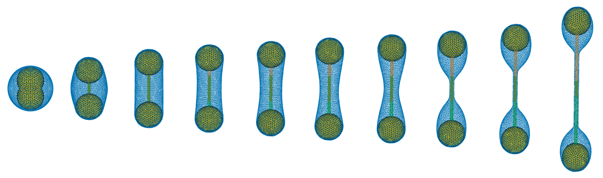

# MeshBrane



A library for modeling biological membranes.

## Installation

```bash
git clone --recursive git@github.com:wlough/MeshBrane.git
cd MeshBrane
python install.py
```

See `python install.py -h` for a complete list of optional flags.

## Dependencies

MeshBrane requires the following libraries and tools to be installed and available in the build environment:

* [Eigen](https://gitlab.com/libeigen/eigen)
* [yaml-cpp](https://github.com/jbeder/yaml-cpp)
* [ffmpeg](https://github.com/FFmpeg/FFmpeg)

The following dependencies are included in the repository as Git submodules:

* [libigl](https://libigl.github.io)
* [tinyply](https://github.com/ddiakopoulos/tinyply)


## Examples

```bash
build/bin/rigid_spindle_sim data/parameter_files/rigid_spindle_params.yaml
```

<!-- ```bash
build/bin/param_sweep data/parameter_files/phase_diagram_sweep_radius_p65_p45_p25_p15_force_5e1_1e2_2e2_4e2.yaml
``` -->
